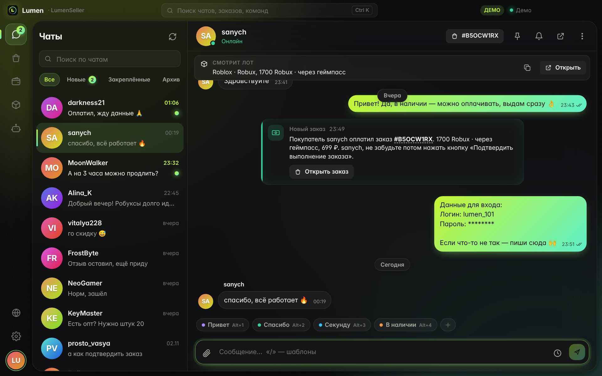
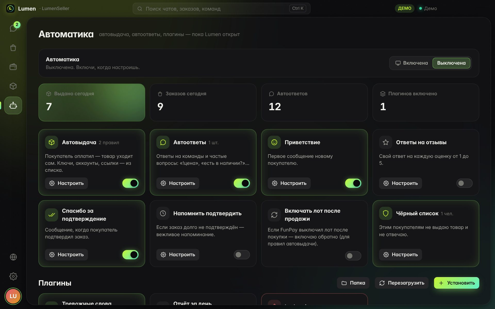
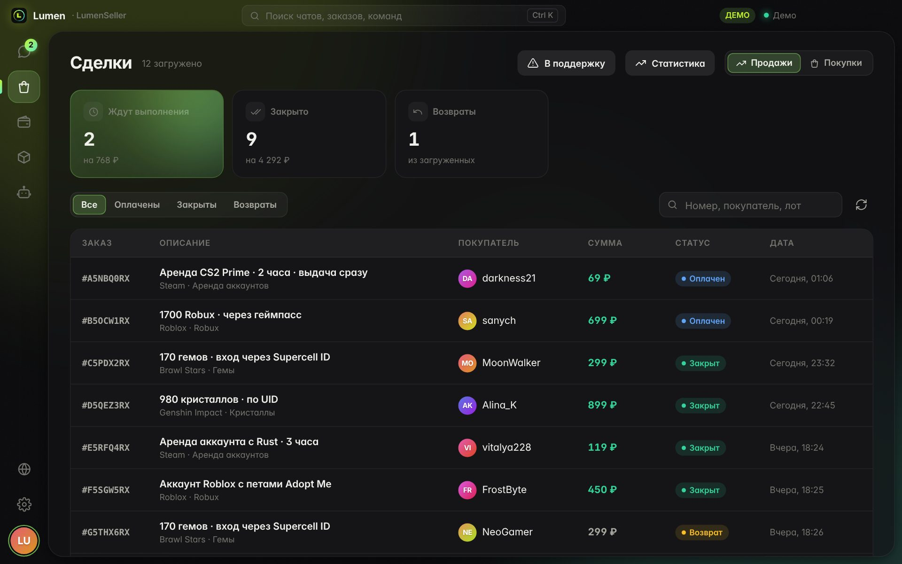
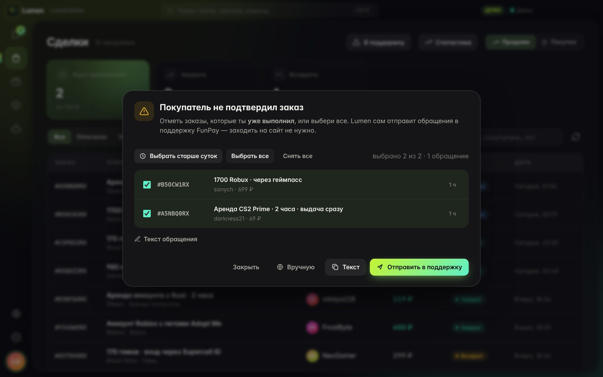
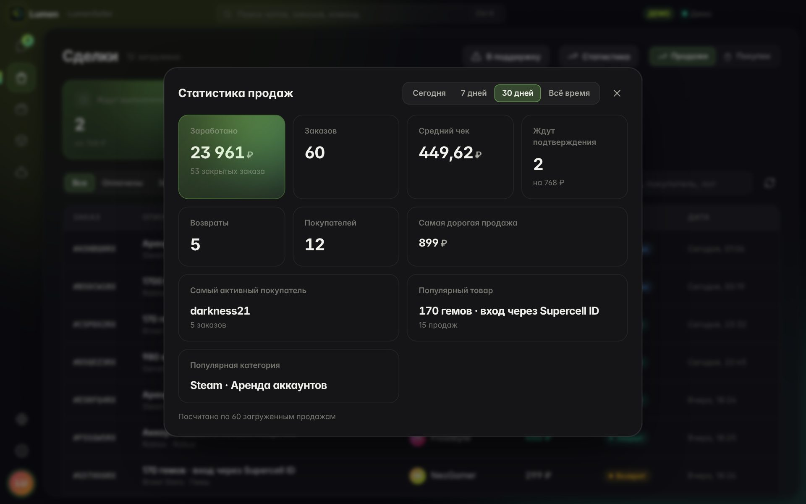
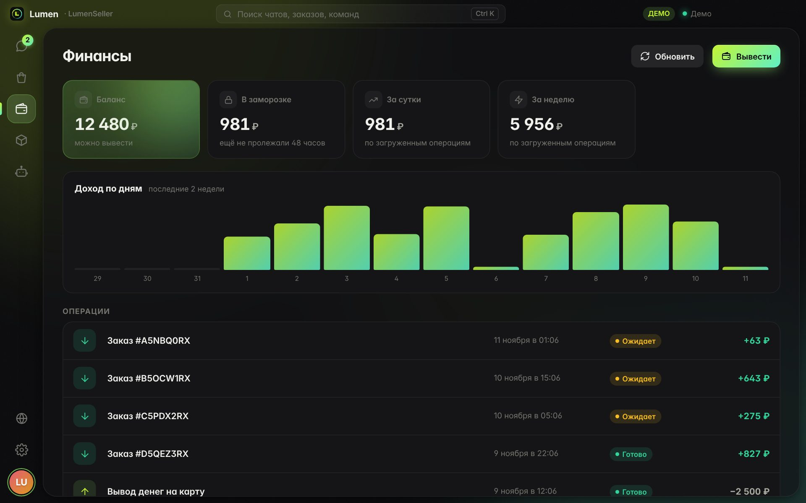
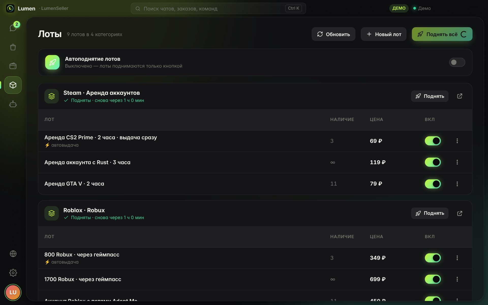
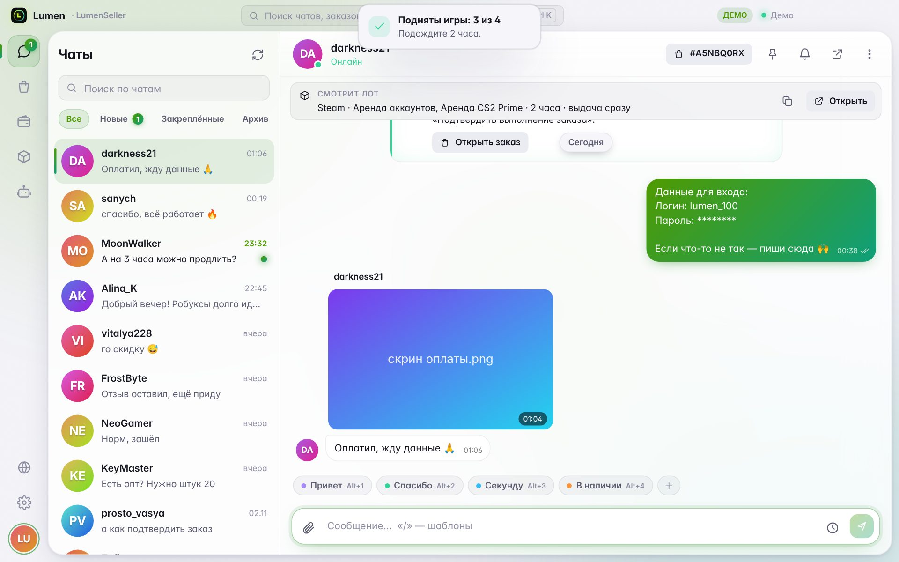

<div align="center">


# Lumen

**Красивый клиент FunPay для компьютера**

Чаты, сделки, финансы и лоты в одном окне. Автовыдача, автоответы, автоподнятие, обращения в поддержку и плагины — прямо в приложении.

[**⬇ Скачать для Windows и macOS**](../../releases/latest) · [🧩 Плагины](docs/PLUGINS.md) · [Сообщить о баге](../../issues/new/choose)

</div>



> [!NOTE]
> Lumen работает с FunPay через твой аккаунт. `golden_key` и куки хранятся **только у тебя на компьютере** в зашифрованном виде и никуда не отправляются.

---

## Содержание

- [Установка](#установка)
- [Обновления](#обновления)
- [Что умеет](#что-умеет)
- [Автоматика и плагины](#автоматика-и-плагины)
- [Скриншоты](#скриншоты)
- [Горячие клавиши](#горячие-клавиши)
- [Запуск из исходников](#запуск-из-исходников)
- [Как устроен проект](#как-устроен-проект)
- [Как выпустить новую версию](#как-выпустить-новую-версию)
- [Вопросы](#вопросы)

---

## Установка

### Windows (рекомендуется)

1. Открой [последний релиз](../../releases/latest).
2. Скачай один из файлов:

   | Файл | Что это |
   |---|---|
   | `Lumen-Setup-x.x.x.exe` | **Установщик.** Ярлык в Пуске и на рабочем столе. **Обновляется сам.** |
   | `Lumen-Portable-x.x.x.exe` | Одна программа без установки, можно носить на флешке. Про новые версии сообщает, но качать их нужно самому. |

3. Запусти. Если Windows покажет синее окно **«Windows защитил ваш компьютер»**, нажми **«Подробнее» → «Выполнить в любом случае»**. Так бывает с любой новой программой без платной цифровой подписи.
4. Войди в FunPay:
   - **Через браузер** (удобнее всего). Откроется обычная страница входа FunPay, после входа окно закроется само. Работает и с кодом подтверждения.
   - **По golden_key.** Открой funpay.com → `F12` → Application → Cookies → `golden_key` → скопируй значение и вставь в Lumen (`Ctrl+V` или кнопка «Вставить»).
   - **Демо.** Можно просто посмотреть программу на выдуманных данных.

### macOS

Скачай из [релизов](../../releases/latest) `Lumen-x.x.x-arm64.dmg` (Mac на M1–M4) или `Lumen-x.x.x-x64.dmg` (Mac на Intel) и перетащи Lumen в «Программы». Программа не подписана сертификатом Apple ($99/год), поэтому первый запуск такой:
1. Открой Lumen из «Программ» → появится окно «не удалось проверить» → **Готово**.
2. **Системные настройки → Конфиденциальность и безопасность** → внизу **«Всё равно открыть»**.

Если пишет «приложение повреждено», выполни в Терминале:
```bash
xattr -cr /Applications/Lumen.app
```

Дальше Lumen открывается как обычная программа.

---

## Обновления

- **Установленная версия (Setup.exe)** раз в 4 часа проверяет GitHub. Если вышла новая версия, она тихо скачивается. В шапке появится кнопка **«Обновить до x.x.x»**: нажми, и Lumen перезапустится уже новым. Если не нажимать, обновление встанет само при следующем выходе из программы.
- **Portable и macOS** показывают в шапке **«Вышла версия x.x.x»**, по нажатию открывается страница загрузки.
- Проверить вручную: **Настройки → О программе → Проверить**. Там же можно выключить автоскачивание.

Аккаунты, шаблоны и настройки при обновлении сохраняются.

---

## Что умеет

**💬 Чаты**
- Папки «Все / Новые / Закреплённые / Архив», поиск, плавная перестановка чатов при новых сообщениях
- Правый клик по чату: закрепить, без звука, архив, прочитано, заметка о покупателе, цветная метка
- В шапке чата — аватарка собеседника и лот, который он смотрит
- Ответ с цитатой, копирование, кликабельные ссылки и номера заказов
- Картинки: скрепка, `Ctrl+V`, перетаскивание в окно; просмотр на весь экран с зумом
- Оповещения FunPay как карточки «Новый заказ / Выполнен / Возврат» с кнопкой «Открыть заказ»
- **Отправить позже**: кнопка с часиками — через 15 минут, час, завтра или в своё время
- Подгрузка старых сообщений при прокрутке вверх

**⚡ Шаблоны**
- Кнопки шаблонов над полем ввода, `Alt+1…9`, поиск по `/` в начале сообщения
- Переменные: `$username` `$welcome` `$order_id` `$order_link` `$lot_name` `$my_name` `$date` `$time`
- **Не беспокоить**: вручную или по расписанию, один автоответ в каждый чат. Не пишет, если бот или автоматика уже ответили
- **ИИ-помощник** (по желанию): кнопка ✨ переписывает черновик вежливо. Подходит любой OpenAI-совместимый сервис

**📦 Сделки и деньги**
- Продажи и покупки: фильтр по статусу, поиск, подгрузка
- Заказ: детали и описание, возврат, подтверждение, отзыв, ответ на отзыв (изменить / удалить)
- **Статистика продаж** за сегодня / 7 дней / 30 дней / всё время: заработок, средний чек, лучший покупатель, популярный товар
- **В поддержку**: покупатель забыл подтвердить заказ — выбираешь все заказы или только выполненные, Lumen сам отправляет обращения в поддержку FunPay (по 5 заказов в каждом)
- Финансы: баланс, заморозка, доход за сутки и неделю, график по дням, подробности каждой операции

**🗂 Лоты**
- Включить / выключить, сменить цену прямо в списке, удалить
- Поднять одну игру или всё сразу; **автоподнятие** ждёт ровно столько, сколько просит FunPay

**🔔 Уведомления**
- Свои всплывающие карточки в любом углу экрана или системные уведомления
- Приходят, даже если сообщение уже прочитал другой бот, телефон или сайт
- 12 звуков на выбор — отдельно для сообщений и для заказов
- Счётчик на иконке, работа из трея, автозапуск вместе с системой

**🎨 Внешний вид**
- Тёмная, светлая или как в системе; готовые акцентные цвета или свой цвет и оттенок фона
- Фон «Аврора», ровный или OLED
- Анимированные ники **Lumen FX** (частицы, плашки, значки, рамки аватарок) — видны в чатах; редактор ника в настройках
- Несколько аккаунтов, `Ctrl+K` — поиск по чатам, заказам и командам
- Сайт FunPay открывается прямо внутри окна (назад / вперёд / обновить)
- Бережёт батарею: когда окно не в фокусе, анимации на паузе

---

## Автоматика и плагины

Работает прямо в приложении, со своим интерфейсом:

| | |
|---|---|
| 📦 **Автовыдача** | Покупатель оплатил — товар (ключ, аккаунт, ссылка) уходит сам. Учитывает количество в заказе, выключает лот, когда товар кончился |
| 💬 **Автоответы** | Ответы на команды и частые вопросы («!цена», «есть в наличии?») |
| 👋 **Приветствие** | Первое сообщение новому покупателю |
| ⭐ **Ответы на отзывы** | Свой текст на каждую оценку 1–5 |
| 🙏 **Спасибо за подтверждение** | Когда покупатель подтвердил заказ |
| ⏰ **Напомнить подтвердить** | Если заказ долго висит неподтверждённым |
| 🚀 **Автоподнятие** | Поднимает лоты ровно тогда, когда FunPay разрешает |
| ♻️ **Восстановление лотов** | Включает лот обратно после продажи |
| 🚫 **Чёрный список** | Этим покупателям не выдаёт и не отвечает |
| 🧩 **Плагины** | Свои функции одним файлом `.js`, можно со своей вкладкой в меню слева — [как написать](docs/PLUGINS.md) |

**Где работает:** пока Lumen открыт или свёрнут в трей. Включается одним переключателем: *Автоматика → «Включена»*.



---

## Скриншоты

| | |
|---|---|
|  |  |
|  |  |
|  |  |

---

## Горячие клавиши

| Клавиши | Действие |
|---|---|
| `Ctrl+K` | Поиск чатов, заказов (`#ABCD1234`) и команд |
| `Ctrl+1…6` | Чаты · Сделки · Финансы · Лоты · Автоматика · Настройки |
| `Ctrl+F` | Поиск по чатам |
| `Alt+1…9` | Вставить шаблон |
| `/` в начале сообщения | Поиск шаблона |
| `Enter` / `Shift+Enter` | Отправить / новая строка |
| `Ctrl+V` | Вставить текст или картинку |
| `Esc` | Закрыть окно, отменить ответ |
| `Ctrl+Shift+I` | Инструменты разработчика |

---

## Запуск из исходников

Нужен только интернет: Node.js скачается сам.

**Windows**
1. Скачай код: зелёная кнопка **Code → Download ZIP** и распакуй его.
2. Дважды кликни **`start.bat`**. Первый раз он сам скачает Node.js (один раз на весь компьютер, в `%LOCALAPPDATA%\Lumen\node` — новые версии используют его же) и поставит зависимости. Если Node.js 18+ уже установлен, ничего не качается.
3. Нужен свой `.exe`? Запусти **`build-exe.bat`**, готовые файлы будут в папке `dist`.

**macOS:** правый клик по **`start.command`** → Открыть.

**Если Node.js уже стоит** (нужна версия 18 или новее):
```bash
npm install
npm start          # запустить
npm test           # тесты: сеть, движок автоматики, разбор страниц
npm run dist:win   # собрать .exe   (на маке: npm run dist:mac)
```

> Своя сборка (`build-exe.bat`) не обновляется сама: обновления работают у версий из Releases.

---

## Как устроен проект

```
lumen-desktop/
├─ main/                 главный процесс приложения
│  ├─ main.js            окна, трей, уведомления, вход через браузер, IPC
│  ├─ fp.js              сеть FunPay: куки, golden_seal (428), runner, картинки, обращения в поддержку
│  ├─ automation.js      автоматика и плагины внутри приложения
│  ├─ store.js           хранилище (ключи шифруются средствами системы)
│  ├─ updater.js         обновления с GitHub Releases
│  └─ preload.js         безопасный мост между окном и главным процессом
├─ engine/               движок автоматики (работает в главном процессе)
│  ├─ engine.js          события FunPay, автовыдача, автоответы, отзывы, поднятие…
│  ├─ plugins.js         загрузка и запуск плагинов
│  ├─ node.js            аккаунт FunPay для Node (разбор страниц через linkedom)
│  └─ defaults.js, fill.js, store.js
├─ renderer/             интерфейс приложения (HTML, CSS, JS-модули без сборщика)
│  └─ js/
│     ├─ fp/             account.js (все действия с FunPay) · parse.js · demo.js
│     ├─ views/          чаты, сделки, финансы, лоты, автоматика, профиль, заказ, настройки
│     ├─ features/       опрос, уведомления, шаблоны, ники Lumen FX, поднятие, отложенные,
│     │                  «не беспокоить», поддержка, вкладки плагинов
│     ├─ plugin-kit/     окружение для страниц плагинов (window.lumen, стили)
│     └─ ui/, core/      компоненты, палитра Ctrl+K, встроенный сайт FunPay, тема, утилиты
├─ docs/                 PLUGINS.md (как писать плагины), скриншоты
├─ test/                 тесты (npm test) + тесты разбора страниц в браузере
├─ start.bat · build-exe.bat           приложение из исходников
├─ start.command · build-mac.command   запуск и сборка .dmg на macOS
└─ .github/workflows/                  сборка и релизы
```

**Как это работает.** Главный процесс ходит на funpay.com (и support.funpay.com — для обращений) с твоими куками, как обычный браузер. Интерфейс получает готовые страницы и разбирает их сам. Новые сообщения приходят тем же способом, что и на сайте: запрос `runner` раз в 2–8 секунд (настраивается).

**Где лежат данные.** Приложение: `%APPDATA%\Lumen` (на маке: `~/Library/Application Support/Lumen`). Там `lumen.json` (аккаунты и настройки), `automation/` (автовыдача, товары) и `plugins/`.

---

## Как выпустить новую версию

Всё собирается само в GitHub Actions, ничего ставить не нужно.

1. Поменяй версию в `package.json`, например `"version": "1.3.0"`. **Без этого обновление не выйдет:** версия должна быть больше прошлой.
2. Допиши, что нового, в `CHANGELOG.md` и закоммить изменения.
3. Открой вкладку **Actions → Release → Run workflow**. Или отправь тег: `git tag v1.3.0 && git push --tags`.
4. Через ~10 минут в **Releases** появится версия с файлами для Windows и macOS. Все, у кого стоит Setup.exe, получат её сами.

Если сборка для Mac долго висит в очереди (у GitHub бывают сбои с маками), собери `.dmg` у себя: дважды кликни **`build-mac.command`** на маке и загрузи файл из `dist` в релиз вручную.

Вкладка **Actions → Build** собирает пробный `.exe` при каждом коммите (он лежит в Artifacts, в Releases не попадает).

---

## Вопросы

**Это безопасно?** Ключ и куки не уходят никуда, кроме funpay.com. На support.funpay.com уходит только его собственная сессия поддержки, `golden_key` туда не отправляется. Если включить ИИ-помощника, на указанный тобой адрес уходит текст переписки. Код открыт — можно проверить.

**Антивирус ругается.** Программа без платной подписи, поэтому некоторые антивирусы осторожничают. Добавь её в исключения или собери сама из исходников.

**Не приходят уведомления.** Проверь, что Lumen в трее (крестик сворачивает, а не закрывает), что не включено «Не беспокоить» и что у чата нет «Без звука».

**Обращение в поддержку не отправилось.** Нажми «Отправить вручную» — откроется форма поддержки FunPay, текст уже будет в буфере. Если ошибка повторяется, открой support.funpay.com через встроенный сайт один раз и попробуй снова.

**Двойные ответы.** Автоматика должна работать в одном месте: либо в Lumen, либо в другом боте. Если на этом аккаунте уже крутится другой бот, выключи автоматику в Lumen.

**Нашёл баг.** [Создай issue](../../issues/new/choose) и приложи скриншот. Логи разработчика открываются по `Ctrl+Shift+I`.

---

<sub>Сторонние лицензии — в `NOTICE.txt`. Шрифт Inter — SIL Open Font License. Lumen не связан с FunPay.</sub>
